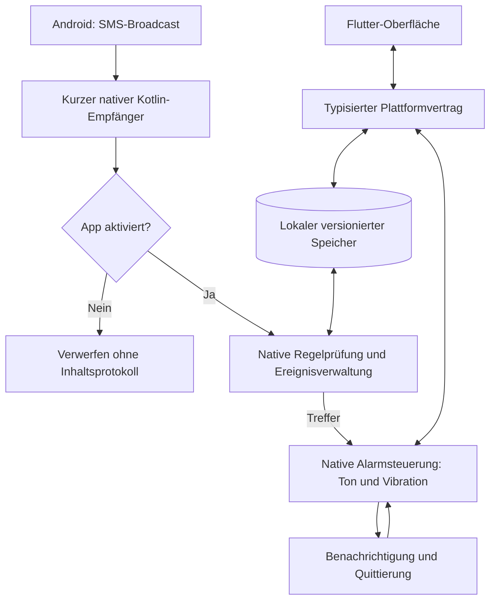

# SMS-Alert: Machbarkeit und Umsetzungsplan

> Arbeitsstand 30.10.2026: Auf ausdrücklichen Folgeauftrag wird der Android-MVP
> vor der ersten manuellen Geräteabnahme fertiggestellt. Das ändert die Reihenfolge
> des ursprünglichen Gates G0, stellt aber keine Pikett-Freigabe dar. Produktentscheidungen
> und tatsächliche Grenzen stehen in [IMPLEMENTATION-DECISIONS.md](IMPLEMENTATION-DECISIONS.md).
> Noch offene reale Tests bleiben in den Issues sichtbar.

Stand: 29. Oktober 2026. Status: Planung, noch kein technischer Nachweis.

GitHub-Übersicht: [Issue #1](https://github.com/Snadretto/SMS-Alert/issues/1).

## Ziel und verbindliche Leitplanken

Die App soll auf einem Smartphone eingehende SMS anhand lokaler Regeln prüfen.
Eine passende Nachricht löst Ton und Vibration aus, bis der Alarm bewusst quittiert
wird. Primärer Einsatz ist die Pikett-Alarmierung von Mitarbeitenden.

- Android zuerst; iOS bleibt ein eigenes, bedingtes Arbeitspaket.
- Flutter für die Oberfläche und gemeinsame Modellverträge; native Anbindungen
  für Funktionen, die das Betriebssystem kontrolliert.
- Keine eigenen Netzwerkverbindungen zur Laufzeit: kein Backend, Push-Dienst,
  Tracking, Remote-Crashreporting, Login, Online-Schriften oder Update-Client.
- SMS werden vom Betriebssystem über das Mobilfunknetz zugestellt. Die App braucht
  dafür keinen eigenen Internetzugriff. Ohne SMS-Zustellung kann sie nicht alarmieren.
- Ein eigener Pausenmodus bleibt bis zur manuellen Reaktivierung gespeichert,
  auch über Prozessneustart, Geräte-Neustart und App-Update hinweg.
- Die Quittierung gilt ausschließlich auf dem Gerät. Es wird keine Bestätigung
  an den Arbeitgeber gesendet.

## Machbarkeit und Grenzen

### Android

Der SMS-Empfang ist über `SMS_RECEIVED_ACTION` und die freigegebene Berechtigung
`RECEIVE_SMS` grundsätzlich möglich, ohne die bestehende SMS-App zu ersetzen.
SMS-Broadcasts gehören zu den Ausnahmen von den Einschränkungen impliziter
Broadcasts. Das beweist noch keinen funktionierenden Alarmstart auf allen
Android-Versionen und Herstellern. [S1], [S2]

Ein laufender Alarm benötigt einen nativen, vom Flutter-Bildschirm unabhängigen
Lebenszyklus. Hintergrundstart, zulässiger Foreground-Service-Typ, Audiofokus,
Vibration und Benachrichtigungen werden zuerst mit einem kleinen Prototyp auf
echten Geräten geprüft. Eine Broadcast-Ausnahme wird nicht mit einer allgemeinen
Foreground-Service-Startfreigabe gleichgesetzt. [S3]

Ein Alarmkanal kann unter den vorgesehenen Bedingungen den Prioritätsmodus von
Nicht stören durchbrechen. Das ist keine pauschale Freigabe für sämtliche
Stummschaltungen. Ab Ziel-API 35 können normale Apps den globalen DND-Zustand
nicht mehr beliebig abschalten. Die Lösung basiert auf erlaubten Ausnahmen und
einer geführten Einrichtung, nicht auf dem Abschalten aller Systemregeln. [S4], [S5]

Ein Vollbildalarm benötigt je nach Android-Version einen speziellen Zugriff;
ohne ihn muss eine geeignete Benachrichtigung mit Quittieraktion verbleiben.
Ton und Quittierung dürfen nicht von einer erzwungenen Activity-Anzeige abhängen.
Eine geschützte Gerätesperre wird nicht aufgehoben. [S6]

**Nicht uneingeschränkt zusicherbar:** Alarmierung bei ausgeschaltetem Gerät,
leerem Akku, fehlender Mobilfunkzustellung, erzwungenem App-Stopp, entzogenen
Rechten, blockierender Firmenrichtlinie, unterdrücktem Audio/Vibrator oder
restriktiver System-/Herstellerkonfiguration. Flugmodus ist kein Internet-Aus-Test.
Bluetooth, Kopfhörer, Telefonate und Alarmlautstärke null brauchen eigene Tests.
Nach einem Neustart ist die Zeit vor der ersten Entsperrung separat zu behandeln;
Direct Boot erfordert passende Komponenten und einen geeigneten Speicher. [S7]

Die gewünschte absolute Zusage „egal in welchem Status“ bleibt ein offener
Anforderungskonflikt. Vor Produktfreigabe braucht es die Zustimmung zu einem
nachgewiesenen Geräte- und Einstellungsprofil. Wird die absolute Zusage verlangt,
ist das ein No-Go für eine gewöhnliche Drittanbieter-App.

### Vertrieb unter Android

Google Play behandelt SMS-Rechte als eingeschränkt. Reine Verbesserungen von
SMS-Hinweisen sind ohne Default-Handler-Rolle oder passende genehmigte Ausnahme
kein automatisch zulässiger Anwendungsfall. Die Ausnahme für das Senden von
Notfall-SMS ist keine pauschale Empfangserlaubnis. [S8]

Der endgültige Vertriebsweg ist offen. Für den Machbarkeitsnachweis ist eine direkt
installierte APK vorgesehen; Play Store, firmeninterne Verteilung und gegebenenfalls
eine vollständige Standard-SMS-App werden bewertet. Eine Default-SMS-App wäre
eine erhebliche Erweiterung des Umfangs. Keine Store-Zusage ohne Prüfung.

### iOS

Eine gewöhnliche Begleit-App kann nicht beliebig alle eingehenden SMS mitlesen.
`IdentityLookup` ist eine eingeschränkte Filter-Erweiterung für unbekannte Absender
und kein allgemeiner SMS-Alarm-Empfänger. [S10]

Es gibt inzwischen eine relevante Sondermöglichkeit: `TelephonyMessagingKit`
für eine gewählte Standard-Carrier-Messaging-App mit entsprechendem Entitlement.
Laut aktueller Apple-Dokumentation müssen Nutzer einen EU-Account haben und sich
mit dem Gerät in der EU befinden. Das ist keine gleichwertige allgemeine Lösung
für die Schweiz. Diese Regionseinschränkung und der Umfang einer Nachrichten-App
müssen vor einer iOS-Umsetzung entschieden werden. [S9]

`AlarmKit` kann nach Nutzerfreigabe geplante Alarme trotz Fokus und Lautlosmodus
auslösen; Critical Alerts benötigen ein gesondertes Apple-Entitlement. Beides
liefert allein keinen universellen SMS-Trigger. Ein Zusammenspiel mit zulässigem
SMS-Empfang ist erst nachzuweisen, einschließlich Hintergrundstart und Quittierung.
Push wäre keine Alternative innerhalb der Offline-Vorgabe. [S11], [S12]

**Ergebnis:** Android ist ein plausibler Kandidat für einen nachzuweisenden MVP.
Ein gleichwertiges, allgemein verfügbares Android-/iOS-Produkt unter allen
ursprünglichen Vorgaben ist derzeit nicht zugesichert.

## Vorgeschlagener MVP

Diese Detailentscheidungen sind Arbeitsannahmen und werden vor der Umsetzung
mit dem Projektinitiator abgestimmt:

1. Regeln aktivieren/deaktivieren, erstellen, ändern und löschen.
2. Kriterien: exakter Absender und/oder wörtlicher Textbestandteil; keine Regex im MVP.
   Eine Regel mit nur einem Kriterium ist zulässig, eine leere Regel nicht.
   Bei zwei Kriterien ist UND der Standard; ODER ist explizit auswählbar.
   Ein Treffer einer beliebigen aktivierten Regel genügt.
3. Numerische Absender mit konfigurierbarem Länderkontext normalisieren;
   Kurzwahlen und alphanumerische Absender separat behandeln. Kein Kontaktezugriff nötig.
4. Ton und Vibration wiederholen sich bis zur bewussten Quittierung;
   kein stiller Ablauf nach wenigen Sekunden. Ein App-Testalarm ist klar gekennzeichnet.
5. Ein Ereignis mit mehreren Regel-Treffern löst nur einen Alarm aus.
   Neue echte SMS bleiben auch bei gleichem Inhalt eigenständige Ereignisse.
   Transport-Duplikate dürfen dedupliziert werden, nicht pauschal alle Wiederholungen.
6. Mehrere offene Ereignisse werden verwaltet, ohne konkurrierende Audioplayer.
   Quittierung eines Ereignisses verwirft keine anderen unquittierten Alarme.
7. App-Pause stoppt als bewusste Aktion einen laufenden Alarm und unterdrückt neue
   SMS-Alarme ohne nachträgliches Abspielen beim Reaktivieren. Im pausierten Zustand
   werden eintreffende Inhalte weder ausgewertet noch protokolliert.
8. Dashboard unterscheidet „aktiviert/pausiert“ von „Einrichtung vollständig/
   eingeschränkt/ungeprüft“. Ein vorhandener Schalter ist kein Zuverlässigkeitsnachweis.
9. Lokal begrenztes Ereignisprotokoll für Treffer und Quittierungen;
   standardmäßig keine dauerhafte Speicherung vollständiger SMS-Texte.
10. Keine ausgehenden SMS, keine Serverquittierung, kein RCS-/MMS-/Messenger-Empfang
    im Android-MVP. Verspätet zugestellte SMS werden als bei Empfang neue SMS behandelt;
    Versand- und Empfangszeit werden unterschieden, kein historischer Postfach-Import.

## Architekturvorschlag

- Flutter verwaltet die Bedienoberfläche; SMS-Empfang und Alarm funktionieren
  auch ohne aktive Flutter-Engine und ohne geöffnete Activity.
- Ein nativer Speicher ist auf Android die verbindliche Quelle für Regeln,
  Aktivierungszustand und offene Ereignisse. Änderungen werden transaktional
  übernommen, damit ein Pausieren nicht mit einem Alarmstart konkurriert.
- DTOs, Schema-Versionen und Referenz-Testfälle halten Oberfläche und native
  Regelprüfung konsistent. Eine künftige Swift-Anbindung implementiert denselben
  Vertrag erst nach positivem iOS-Entscheid. [S13]
- Ein Foreground Service läuft nur während eines begründeten aktiven Alarms,
  sofern der Machbarkeitsnachweis das bestätigt. Kein permanentes Polling,
  kein WorkManager als Echtzeit-SMS-Ersatz und kein Flutter-Timer als Alarmmotor.
- Möglichst nur tatsächlich benötigte Rechte. `READ_SMS`, `SEND_SMS`, Kontakte,
  Standort und Notification-Listener gehören nicht zur Ausgangsarchitektur.
- Kein globales Abschalten von DND; Lautstärke-/Audioänderungen müssen erklärt,
  begrenzt und nach dem Alarm konfliktfrei bereinigt werden. Nutzeränderungen
  während eines Alarms dürfen nicht blind überschrieben werden.
- Release-Artefakt ohne `INTERNET` und ohne Netzwerk-SDKs; zusammengeführte
  Manifeste und transitive Abhängigkeiten prüfen. Build-/CI-Downloads sind
  von den Netzwerkverbindungen der installierten App zu unterscheiden.
- Sensible Daten aus System-/Cloud-Backups ausschließen und Verhalten prüfen;
  keine SMS-Inhalte in Systemlogs oder Crashausgaben. Sperrbildschirm zeigt
  standardmäßig keine Nachrichtentexte. Senderkennung ist kein Echtheitsbeweis:
  SMS-Inhalte lösen keine Befehle, URLs oder sonstigen automatischen Aktionen aus.

## Phasen und Arbeitspakete

| Phase | Paket | Ergebnis | Voraussetzung |
| --- | --- | --- | --- |
| M0: Entscheidungen | A01 Android-Machbarkeitsnachweis | Reale SMS startet Alarm aus kaltem Prozess; DND-/Audio-/Hintergrundgrenzen gemessen | Reale Android-Testgeräte |
| M0: Entscheidungen | A02 Vertrieb und Rechte | Tragfähiger APK-/Store-Weg und begründeter Berechtigungsumfang | Keine |
| M0 / iOS separat | I01 iOS-Machbarkeit | Entscheidung je Zielregion und Nachrichten-App-Umfang; kein blindes Feature-Versprechen | Apple-Testmöglichkeiten für praktischen Nachweis |
| M1: Android-MVP | A03 Flutter-Grundlage | Reproduzierbarer Build, native Schnittstellen, SDK-Versionen, lokale Speicherverträge | A01, A02 |
| M1: Android-MVP | A04 Regeln und Speicher | Getestete native Regelauswertung, Persistenz und Datenmigration | A03 |
| M1: Android-MVP | A05 SMS-Empfang | Mehrteilige Nachrichten, verschiedene Absender, Dual-SIM und Deduplizierung | A01, A04 |
| M1: Android-MVP | A06 Alarm und Quittierung | Wiederholter Ton/Vibration, mehrere Ereignisse und robuste Stop-Aktion | A01, A04, A05 |
| M1: Android-MVP | A07 Einrichtung und Diagnose | Geführte Rechtevergabe, prüfbarer Status und Testalarm | A03, A06 |
| M1: Android-MVP | A08 Flutter-Bedienung und Pause | Regeln, Status, Alarmansicht und dauerhafte App-Pause | A04, A06, A07 |
| M2: Härtung | A09 Lebenszyklus und Wiederanlauf | Prozessende, Neustart, Updates und Direct-Boot-Entscheid nachweisbar behandelt | A05, A06, A08 |
| M2: Härtung | A10 Datenschutz und Offline-Nachweis | Minimalprotokoll, Löschung, Backup-Regeln und geprüftes Release-Artefakt | A03–A09 |
| M2: Abnahme | A11 Geräte- und Dauertests | Freigegebene Kombinationen mit Messwerten und dokumentierten Ausschlüssen | A07–A10 |
| M3: Pilot | A12 Pilot und Release | Signierte APK, Installation/Update-Anleitung und begrenzte Pilotfreigabe | A02, A10, A11 |

Der GitHub-Plan enthält zusätzlich ein zentrales Übersichts-Issue.
Die konkrete Zuordnung steht im [Issue-Verzeichnis](ISSUES.md).

### Freigabepunkte

- **G0:** A01 und A02 müssen eine belastbare Android-Route ergeben, bevor der
  vollständige MVP gebaut wird. Technische oder vertriebliche Blocker führen
  zur Anpassung des Umfangs, nicht zu verdeckten Umgehungen.
- **G1:** MVP funktioniert ohne laufenden Flutter-Bildschirm und hält die App-Pause ein.
- **G2:** Datenschutz- und Geräteprüfung sind bestanden. Ein Emulator allein reicht nicht.
- **G3:** Pilotfreigabe mit konkret benannten Geräten/Versionen; keine universelle
  Alarmgarantie. Arbeitgeber-/Leitstellen-Zustellkontrolle ist nicht Teil dieser App.
- **iOS:** Unabhängiger Go/No-Go nach I01; iOS blockiert die Android-Planung nicht.

## Test- und Abnahmekonzept

- Unit-/Vertragstests: Kriterienlogik, Nummern und Kurz-/Textabsender, Unicode,
  Groß-/Kleinschreibung, leere Regeln, Migrationen, Pause-/Quittierungsrennen.
- Android-Integration: echte geschützte SMS-Broadcasts sowie Simulatorfälle für
  Mehrteiler, Duplikate, Dual-SIM, mehrere Treffer und Ereigniswarteschlange.
- Reale Geräte: zunächst Pixel und Samsung sowie ein Gerät mit restriktiver
  Energieverwaltung; konkrete Modelle und Mindestversion nach A01 festlegen.
  Ziel-SDK nach den zum Release aktuellen Vorgaben wählen; mindestens die
  Verhaltensgrenzen ab Android 12, 13, 14 und 15 gezielt berücksichtigen.
- Zustände: laut, Vibration, lautlos, verschiedene DND-Regeln, Alarmlautstärke null,
  Display aus/gesperrt, App nicht geöffnet, Doze, Energiesparen, Telefonat,
  Bluetooth/Kopfhörer, Prozessende, erzwungener Stopp, Neustart vor/nach Entsperrung,
  Berechtigungsentzug und App-Pause. Unterstützt, eingeschränkt und nicht möglich
  werden getrennt dokumentiert; negative Fälle sind keine erfolgreich bestandenen
  Alarmfälle. Pause und Reaktivierung auch mit gleichzeitig eintreffender SMS prüfen.
- Wiederholungen und Latenzen pro Kombination protokollieren. Vorläufiges Messziel:
  Alarmstart innerhalb von 5 Sekunden ab Übergabe der vollständigen SMS durch Android,
  ohne unterdrückte berechtigte Ereignisse im definierten Wiederholungslauf.
  Das ist weder eine SMS-Zustellzeit-Zusage noch ein bereits belegter Messwert.
- Daueralarm mindestens 30 Minuten als Belastungstest; das ist kein geplanter Timeout.
  Dauerbetrieb, Energiebedarf, Aufräumen von Audio/Vibration/Wake-Locks und
  idempotente Quittierung messen. Wiederanlauf darf quittierte Alarme nicht reaktivieren.
- Offline-Test mit aktivem Mobilfunk/SMS, abgeschalteten Daten und WLAN; zusätzlich
  Netzwerkversuche instrumentiert prüfen, nicht allein aus fehlendem Empfang ableiten.

## Noch offene Produktentscheidungen

- Vertriebsweg: direkte APK/firmenintern, Google Play oder mehrere Varianten.
- Android-Mindestversion, konkrete Testgeräte, Dual-SIM-/eSIM-Anforderungen.
- iOS-Zielregionen, insbesondere Schweiz gegenüber EU; Bereitschaft zum Umfang
  einer vollständigen Standard-Nachrichten-App.
- Akzeptierte Betriebsgrenzen statt einer absoluten Garantie für jeden Zustand.
- Verhalten bei Telefonaten, Lautstärkeänderungen, mehreren Alarmen und App-Pause
  während eines laufenden Alarms; oben stehen Vorschläge, keine bereits freigegebenen Details.
- Vor-Entsperrungs-Betrieb und dessen Datenschutzabwägung; Protokoll-Aufbewahrungsdauer.
- CI- und Release-Signierung. Signierschlüssel gehören nicht ins Repository.

## Offizielle Quellen

- [S1: Android SMS-Broadcast](https://developer.android.com/reference/android/provider/Telephony.Sms.Intents#SMS_RECEIVED_ACTION)
- [S2: Ausnahmen für implizite Broadcasts](https://developer.android.com/develop/background-work/background-tasks/broadcasts/broadcast-exceptions)
- [S3: Hintergrundstart von Foreground Services](https://developer.android.com/develop/background-work/services/fgs/restrictions-bg-start)
- [S4: DND-Ausnahme eines Benachrichtigungskanals](https://developer.android.com/reference/android/app/NotificationChannel#setBypassDnd(boolean))
- [S5: Android 15 und Änderungen am globalen DND-Zustand](https://developer.android.com/about/versions/15/behavior-changes-15)
- [S6: Vollbild-Benachrichtigungen ab Android 14](https://source.android.com/docs/core/permissions/fsi-limits)
- [S7: Direct Boot](https://developer.android.com/privacy-and-security/direct-boot)
- [S8: Google-Play-Regeln für SMS-Berechtigungen](https://support.google.com/googleplay/android-developer/answer/10208820?hl=en-GB)
- [S9: Apple TelephonyMessagingKit](https://developer.apple.com/documentation/telephonymessagingkit)
- [S10: Apple IdentityLookup und Grenzen der Filter-Erweiterung](https://developer.apple.com/videos/play/wwdc2017/249/)
- [S11: Apple AlarmKit](https://developer.apple.com/documentation/alarmkit/scheduling-an-alarm-with-alarmkit)
- [S12: Apple Critical Alerts](https://developer.apple.com/documentation/bundleresources/entitlements/com.apple.developer.usernotifications.critical-alerts)
- [S13: Flutter-Plattformanbindungen](https://docs.flutter.dev/platform-integration/platform-channels)
